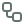
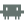

  

# Konstantin Sinitsyn

### Product AI Builder

AI-продукты · аналитика · разработка · автоматизация

### Опыт и результаты

  

### Skills

**Продукт и пользовательский опыт**

  &nbsp;Product&nbsp;Discovery &nbsp;&nbsp; &nbsp;CustDev &nbsp;&nbsp; &nbsp;CJM&nbsp;&amp;&nbsp;UX 
  &nbsp;MVP&nbsp;&amp;&nbsp;Prototyping &nbsp;&nbsp; &nbsp;Prioritization &nbsp;&nbsp; &nbsp;Product&nbsp;Requirements

**AI и автоматизация**

  &nbsp;AI&nbsp;Agents &nbsp;&nbsp; &nbsp;Prompt&nbsp;Engineering &nbsp;&nbsp; &nbsp;MCP 
  &nbsp;Workflow&nbsp;Automation &nbsp;&nbsp; &nbsp;LLM&nbsp;Evaluation &nbsp;&nbsp; &nbsp;AI-assisted&nbsp;Dev

**Данные и аналитика**

  &nbsp;Data&nbsp;Analysis &nbsp;&nbsp; &nbsp;Web&nbsp;Scraping &nbsp;&nbsp; &nbsp;Product&nbsp;Metrics 
  &nbsp;Hypothesis&nbsp;Testing &nbsp;&nbsp; &nbsp;Data&nbsp;Validation &nbsp;&nbsp; &nbsp;Technical&nbsp;SEO

### Tools

  &nbsp;ChatGPT &nbsp;&nbsp; &nbsp;Codex &nbsp;&nbsp; &nbsp;Playwright &nbsp;&nbsp; &nbsp;MCP &nbsp;&nbsp; &nbsp;Claude&nbsp;Code &nbsp;&nbsp; &nbsp;Cursor

  

### Подходы и текущий фокус

- **CJM-first:** сценарий → прототип → проверка.
- **AI-assisted development:** короткие итерации и проверка гипотез.
- **Evals:** контрольные примеры и регрессионные проверки.
- **В фокусе:** мультиагентные системы, управление контекстом и agent skills.

### Контакты

  &nbsp;
  

