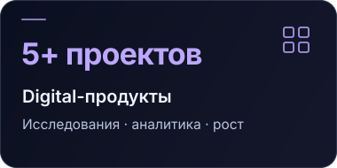
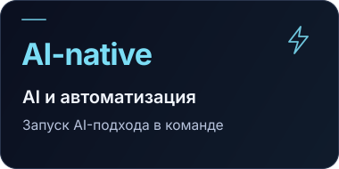

  

  <b>Привет, я Константин.</b> Соединяю продукт, AI, аналитику и разработку. 
  От исследования идеи до прототипа, запуска и измеримого результата.

  
  

### Highlights

  
  
  

### Skills

  
  
  
   
  
  
  
  

<b>Раскрыть направления экспертизы</b>

| Product | AI & automation | Analytics |
| --- | --- | --- |
| CustDev · CJM · UX-сценарии | Промпты · AI-агенты · автоматизация | Метрики · гипотезы · эксперименты |
| MVP · приоритизация · требования | AI-assisted development · оценка ответов | Анализ данных · поисковый спрос · SEO |

### Tools & stack

  
  
  

  

<b>Стек по задачам</b>

- **AI и прототипы:** ChatGPT · Codex · VS Code.
- **Сбор и обработка данных:** Python · JavaScript · Node.js · Playwright · CSV / JSON.
- **Веб и рабочий процесс:** HTML · CSS · Git · GitHub.

