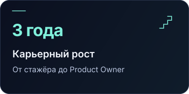
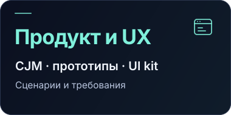
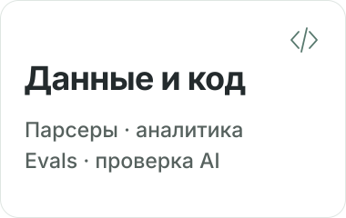

  

<h1 align="center">Konstantin Sinitsyn</h1>
<h3 align="center">Product AI Builder</h3>

  AI-продукты · аналитика · разработка · автоматизация

> **Привет, я Константин. Соединяю продукт, AI, аналитику и разработку.** 
> От исследования идеи до прототипа, запуска и измеримого результата.

### Опыт и результаты

  
  
  

  
  

### Skills

**Продукт и пользовательский опыт**

  
  
  
  
  
  

**AI и автоматизация**

  
  
  
  
  
  

**Данные и аналитика**

  
  
  
  
  
  

### Tools

  
  
  
  
  
  

ChatGPT и Codex — основной рабочий контур. Claude Code, Cursor и MCP — в работе и экспериментах с агентами и подключением инструментов.

  

Python · JavaScript · Node.js · Playwright · Git · GitHub · VS Code 
Форматы и рабочие материалы: JSON · CSV · Markdown · инструкции и skills для агентов.

### Подходы и текущий фокус

  
  
  

- **CJM-first.** Пользовательский путь, сценарии и критерии результата — до реализации.
- **AI-assisted development.** Быстрые прототипы, короткие итерации и проверка гипотез на рабочих решениях.
- **Evals и регрессии.** Контрольные примеры, пограничные случаи и воспроизводимые проверки алгоритмов и ответов AI.
- **Мультиагентные системы.** В фокусе — роли агентов, декомпозиция задач, передача контекста и независимая проверка результата.
- **Контекст и agent skills.** Развиваю подход к структурированным библиотекам знаний и переиспользуемым инструкциям в GitHub.

---

  
  

